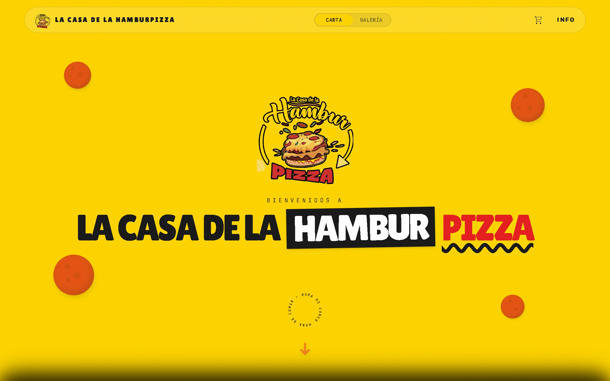
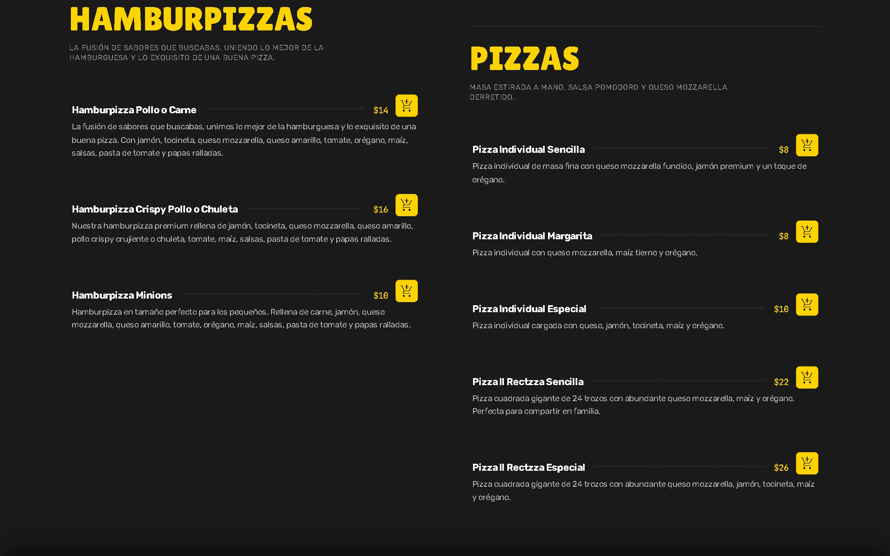
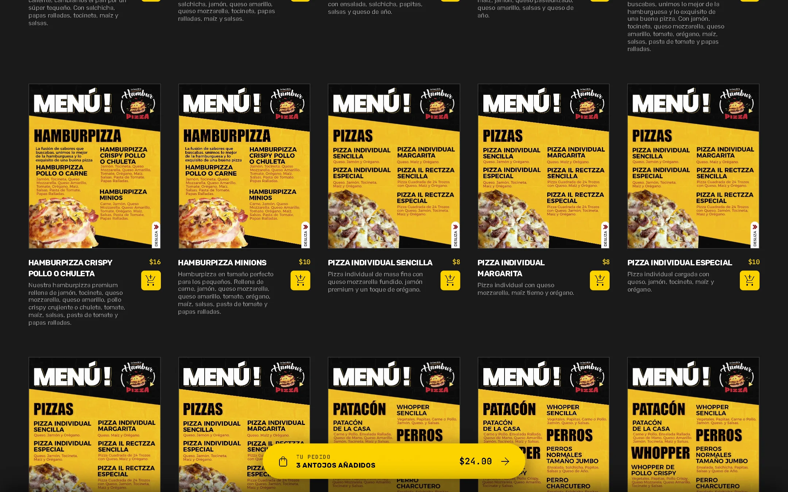
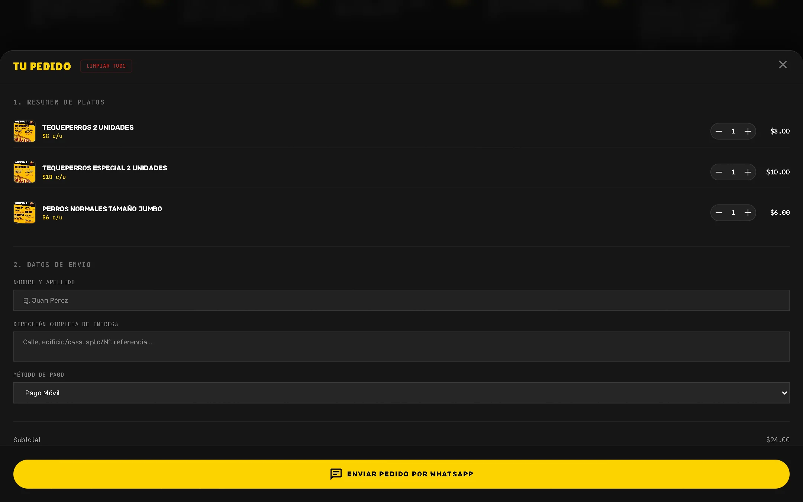
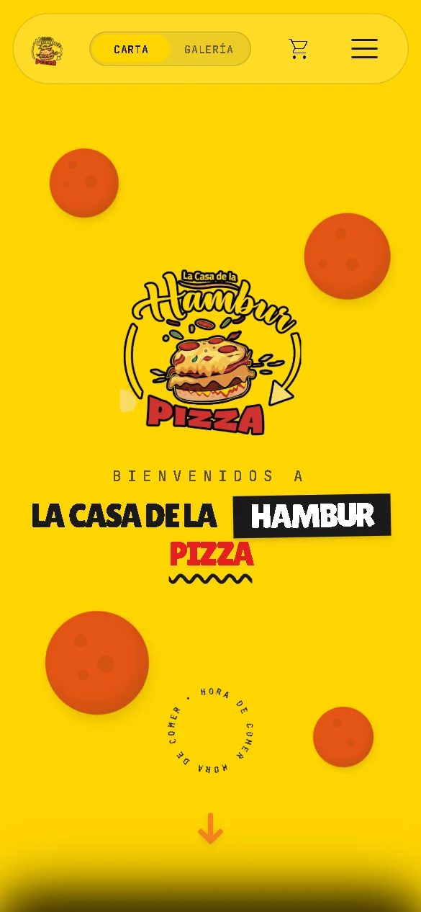
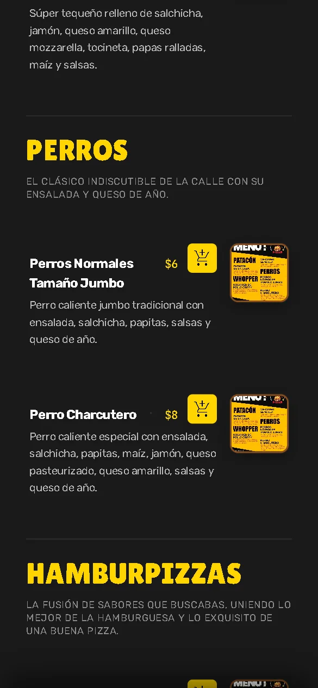
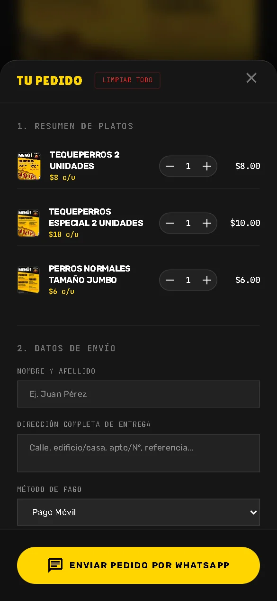

# Menú Digital

A mobile-first digital menu for **La Casa de la Hamburpizza**, a restaurant in Trujillo, Venezuela. Customers browse the menu, build an order, and send it straight to the restaurant through WhatsApp. No backend required: the whole site is statically generated.

<p align="center">
  
</p>

## Features

- **Two ways to browse**: an editorial two-column menu and a visual gallery view, switchable from the navbar.
- **Cart with persistence**: items, quantities and totals survive page reloads (stored in `localStorage`).
- **Order via WhatsApp**: a checkout drawer collects name, address and payment method, validates the form, and opens a pre-filled WhatsApp message.
- **Scroll-driven animation**: the cover scales away and the menu card slides up with a parallax reveal (GSAP). Smooth scrolling (Lenis) is enabled on desktop only, and `prefers-reduced-motion` is respected.
- **Mobile first**: every surface (navbar, drawers, buttons) is designed for small viewports first and scales up.
- **SEO ready**: descriptive meta tags, Open Graph data and `robots.txt`.

## Screenshots

### Desktop

| Menu | Gallery |
| --- | --- |
|  |  |

<p align="center">
  
</p>

### Mobile

| Cover | Menu | Order |
| --- | --- | --- |
|  |  |  |

## Tech Stack

| Area | Choice |
| --- | --- |
| Framework | [Astro](https://astro.build) 7 (static site generation) |
| Styling | [Tailwind CSS](https://tailwindcss.com) 4 |
| Animation | [GSAP](https://gsap.com) |
| Smooth scroll | [Lenis](https://lenis.darkroom.engineering) |
| Language | TypeScript (strict) |
| Runtime | Node.js >= 22.12 |

## Getting Started

```sh
git clone https://github.com/alfonsojms/menudigital.git
cd menudigital
npm install
npm run dev
```

The site is served at `http://localhost:4321`.

| Command | Description |
| --- | --- |
| `npm run dev` | Start the development server |
| `npm run dev:host` | Start the dev server exposed on the local network (handy for testing on a phone) |
| `npm run build` | Build the production site into `dist/` |
| `npm run preview` | Preview the production build locally |

## Project Structure

```text
src/
├── animations/   # GSAP timelines (menuAnimations.ts)
├── components/
│   ├── common/   # Navbar, Loader, GrainOverlay, AddToCartBtn, Badge
│   └── menu/     # Cover, MenuCanvas, MenuGallery, DishProfile, OrderSheet, FloatingCartBar, Dossier
├── layouts/      # Base layout, global scripts and SEO tags
├── pages/        # index.astro, the single page of the site
├── styles/       # Tailwind entry point and design tokens
├── types/        # Menu data types
└── utils/        # cartStore.ts, cart state and persistence
```

## Design Notes

The visual language (colors, typography, spacing) is documented in [`design.md`](design.md), and product goals in [`PRODUCT.md`](PRODUCT.md).

## Contributing

Commits follow [Conventional Commits](https://www.conventionalcommits.org) (`feat:`, `fix:`, `refactor:`, `perf:`, `build:`, `docs:`).
